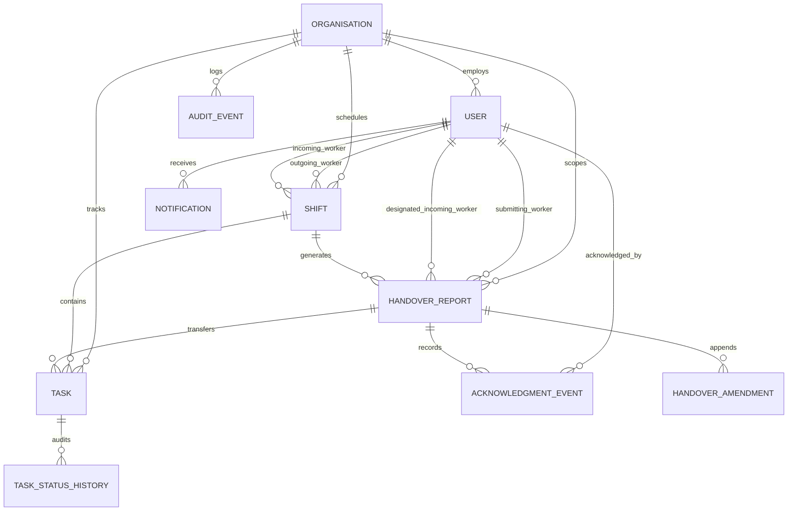

# ShiftSync — PostgreSQL Relational Database Schema Documentation

ShiftSync uses **PostgreSQL 18** (`shiftsync_db`) managed via Django ORM migrations (`accounts`, `operations`, `notifications`).

---

## 1. Entity-Relationship Diagram

---

## 2. Core Database Tables & Constraints

### 2.1 `accounts_organisation` (`Organisation`)
| Column | Type | Constraints / Purpose |
| :--- | :--- | :--- |
| `id` | `UUID` | Primary Key |
| `name` | `VARCHAR(180)` | `UNIQUE`, `NOT NULL` |
| `code` | `VARCHAR(40)` | `UNIQUE`, `INDEXED` (e.g., `KQ-MRO`) |
| `industry` | `VARCHAR(120)` | Sector descriptor |
| `departments` | `JSONB` | Configured departments list |
| `task_categories` | `JSONB` | Configurable task categories |
| `priority_levels` | `JSONB` | `["Low", "Medium", "High", "Critical"]` |
| `low_confidence_threshold` | `FLOAT` | Default `60.0` (%) |
| `require_acknowledgment_notes` | `BOOLEAN` | Default `FALSE` |
| `nlp_enabled` | `BOOLEAN` | Default `TRUE` |
| `created_at` / `updated_at` | `TIMESTAMPTZ` | Timezone-aware UTC timestamps |

### 2.2 `accounts_user` (`User` — Custom `AUTH_USER_MODEL`)
| Column | Type | Constraints / Purpose |
| :--- | :--- | :--- |
| `id` | `UUID` | Primary Key |
| `email` | `VARCHAR(254)` | `UNIQUE`, `INDEXED` (`USERNAME_FIELD`) |
| `password` | `VARCHAR(128)` | PBKDF2-SHA256 hashed credential |
| `full_name` | `VARCHAR(150)` | Worker / Supervisor / Admin full name |
| `employee_id` | `VARCHAR(50)` | Badge / Staff identifier |
| `role` | `VARCHAR(30)` | `OUTGOING_WORKER`, `INCOMING_WORKER`, `SUPERVISOR`, `ADMIN` |
| `organisation_id` | `UUID` (FK) | `ON DELETE PROTECT` -> `accounts_organisation` |
| `department` | `VARCHAR(120)` | Assigned operational unit |
| `is_active` | `BOOLEAN` | `INDEXED`, enforced on login and token refresh |
| `created_at` / `updated_at` | `TIMESTAMPTZ` | Timezone-aware UTC timestamps |

### 2.3 `operations_shift` (`Shift`)
| Column | Type | Constraints / Purpose |
| :--- | :--- | :--- |
| `id` | `UUID` | Primary Key |
| `organisation_id` | `UUID` (FK) | `ON DELETE PROTECT` |
| `name` | `VARCHAR(150)` | Shift title |
| `department` | `VARCHAR(120)` | Operational department |
| `shift_date` | `DATE` | `INDEXED` |
| `start_time` / `end_time` | `TIME` | Shift window |
| `outgoing_worker_id` | `UUID` (FK) | `ON DELETE PROTECT` -> `accounts_user` |
| `incoming_worker_id` | `UUID` (FK) | `ON DELETE PROTECT` -> `accounts_user` |
| `supervisor_id` | `UUID` (FK) | `NULLABLE`, `ON DELETE PROTECT` -> `accounts_user` |
| `status` | `VARCHAR(20)` | `SCHEDULED`, `ACTIVE`, `COMPLETED`, `CANCELLED` |

### 2.4 `operations_handoverreport` (`HandoverReport`)
| Column | Type | Constraints / Purpose |
| :--- | :--- | :--- |
| `id` | `UUID` | Primary Key |
| `report_code` | `VARCHAR(40)` | `UNIQUE`, `INDEXED` (e.g., `HND-20261023-A1B2C3`) |
| `organisation_id` | `UUID` (FK) | `ON DELETE PROTECT` |
| `shift_id` | `UUID` (FK) | `ON DELETE PROTECT` -> `operations_shift` |
| `submitting_worker_id` | `UUID` (FK) | `ON DELETE PROTECT` -> `accounts_user` |
| `designated_incoming_worker_id` | `UUID` (FK) | `ON DELETE PROTECT` -> `accounts_user` |
| `acknowledged_by_id` | `UUID` (FK) | `NULLABLE`, `ON DELETE PROTECT` -> `accounts_user` |
| `equipment_status` | `VARCHAR(40)` | `OPERATIONAL`, `MINOR_ISSUE`, `MAINTENANCE_REQUIRED`, `CRITICAL_FAULT` |
| `safety_issues` | `TEXT` | Safety observations and near misses |
| `status` | `VARCHAR(20)` | `DRAFT`, `SUBMITTED`, `ACKNOWLEDGED` |
| `created_at` / `submitted_at` / `acknowledged_at` | `TIMESTAMPTZ` | Audit timestamps |

### 2.5 `operations_task` (`Task`)
| Column | Type | Constraints / Purpose |
| :--- | :--- | :--- |
| `id` | `UUID` | Primary Key |
| `organisation_id` | `UUID` (FK) | `ON DELETE PROTECT` |
| `shift_id` | `UUID` (FK) | `ON DELETE PROTECT` |
| `handover_report_id` | `UUID` (FK) | `NULLABLE`, `ON DELETE CASCADE` (for draft cleanup) |
| `description` | `TEXT` | Natural language task description |
| `category` / `confirmed_category` | `VARCHAR(80)` | Worker-confirmed final category |
| `priority` / `confirmed_priority` | `VARCHAR(20)` | `Low`, `Medium`, `High`, `Critical` |
| `model_suggested_category` | `VARCHAR(80)` | Original NLP category prediction |
| `model_suggested_priority` | `VARCHAR(20)` | Original NLP priority prediction |
| `category_confidence` / `priority_confidence` / `confidence_score` | `FLOAT` | Model confidence percentages |
| `was_overridden` | `BOOLEAN` | `TRUE` when worker overrides NLP suggestion |
| `status` | `VARCHAR(25)` | `Pending`, `In Progress`, `Completed` |
| `is_carried_forward` | `BOOLEAN` | `TRUE` when unfinished work is carried into incoming shift |

### 2.6 Supporting Audit & Accountability Tables
- **`operations_acknowledgmentevent`**: Immutable record of explicit incoming handover sign-off (`acknowledged_by`, `acknowledged_at`, `unresolved_tasks_count`, `critical_tasks_count`, `ip_address`) with `ON DELETE PROTECT`.
- **`operations_taskstatushistory`**: Tracks every status and priority transition of a task with `ON DELETE PROTECT`.
- **`operations_handoveramendment`**: Stores authorised post-submission amendments without overwriting submitted handover records.
- **`accounts_auditevent`**: Organisation-scoped security and operational audit trail with `ON DELETE PROTECT`.
- **`notifications_notification`**: Persistent in-app notifications with unread counters and `read_at` timestamps.
